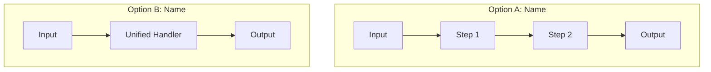

# /compare - Universal Visual Comparison Engine

$ARGUMENTS

---

## 🎯 Purpose & Core Principles

Activates **UNIVERSAL COMPARISON MODE** to perform rigorous, crystal-clear, and visually rich side-by-side analyses between any two entities (or variations): files, functions, algorithms, features, architectures, workflows, configs, prompts, or specs.

> **IRON INVARIANTS:**
> 1. **OBJECTIVE & EVIDENCE-BASED:** Ground every comparison point in empirical facts, syntax, logic, performance, or concrete trade-offs. No superficial or vague generalizations.
> 2. **MAXIMUM VISUAL CLARITY:** Always utilize side-by-side tables, parity checklists, ASCII/Mermaid diagrams, and diff blocks to make differences instantly recognizable at a glance.
> 3. **SYMMETRICAL RIGOR:** Evaluate Entity A and Entity B with equal depth across the exact same evaluation criteria.
> 4. **DECISION-DRIVEN VERDICT:** Always provide a clear, contextual decision matrix (When to choose A vs When to choose B) rather than leaving the decision open-ended.
> 5. **NON-DESTRUCTIVE:** Comparison is strictly analytical and read-only unless the user explicitly requests merging, porting, or migrating.

---

## ⚙️ Argument Parsing & Flags

```text
/compare <Target A> vs <Target B> [flags]
/compare <Target A> <Target B> [flags]
```

### Supported Flags:
- `--deep`: Runs exhaustive line-by-line / AST / edge-case deep dive (best for complex code/architecture).
- `--matrix`: Generates an expanded multidimensional scoring and parity matrix.
- `--diff`: Emphasizes raw semantic and structural diffs between the two items.
- `--out`: Saves output to `reports/COMPARE-<YYYYMMDD>-<slug>.md`.
- `$ARGUMENTS`: Paths to 2 files, names of 2 functions, 2 workflows, 2 libraries, or 2 concepts/descriptions.

---

## 📂 Supported Comparison Target Types

| Category | Example Target A | Example Target B | Primary Focus Dimensions |
| :--- | :--- | :--- | :--- |
| **Files & Code** | `src/v1/auth.ts` | `src/v2/auth.ts` | AST/syntax diff, imports, safety, performance, types |
| **Functions & Algorithms** | `quickSort()` | `mergeSort()` | Time/space complexity, readability, stability, edge cases |
| **Features & Solutions** | `JWT in LocalStorage` | `HttpOnly Cookie Session` | Security, UX, scalability, CSRF/XSS vectors |
| **Workflows & Pipelines** | `/cook` | `/vibe` | Steps, safety gates, autonomy, error recovery, speed |
| **Architecture / Stack** | `REST API` | `tRPC / GraphQL` | Type-safety, network overhead, developer ergonomics, caching |
| **Configs & Prompts** | `System Prompt v1` | `System Prompt v2` | Token count, adherence, hallucination risk, clarity |

---

## 🔬 5-Phase Comparison Protocol

```
┌────────────────────────┐     ┌────────────────────────────────┐
│ 1. TARGET EXTRACTION   │ ──► │ 2. ANATOMY DECONSTRUCTION      │
│    & Scope Alignment   │     │    (Core primitives & mechanics)│
└────────────────────────┘     └───────────────┬────────────────┘
                                               │
┌────────────────────────┐     ┌───────────────▼────────────────┐
│ 4. DEEP-DIVE DIFF &    │ ◄── │ 3. VISUAL SIDE-BY-SIDE MATRIX  │
│    Edge-Case Analysis  │     │    (Parity, Speed, UX, DX)     │
└───────────┬────────────┘     └────────────────────────────────┘
            │
┌───────────▼────────────┐
│ 5. VERDICT & DECISION  │
│    Contextual Matrix   │
└────────────────────────┘
```

---

### Phase 1: Target Extraction & Scope Alignment
1. **Locate & Load:** Fetch or inspect the exact definitions of Target A and Target B (read source files, pull symbols, extract text/specs).
2. **Context Baseline:** Identify the shared objective, domain, and operating constraints both entities are designed for.
3. **Equivalence Boundary:** Declare what aspects are directly comparable and what differences are out of scope.

---

### Phase 2: Anatomy & Mechanics Deconstruction
Break down each target into fundamental building blocks:
- **Entity A (`Alpha`):** Mental model, input/output contract, internal mechanism, dependencies, invariants.
- **Entity B (`Beta`):** Mental model, input/output contract, internal mechanism, dependencies, invariants.

---

### Phase 3: Visual Side-by-Side Comparison Matrix
Structure comparisons in a standardized, high-density visual format across key axes:

| Dimension / Criteria | Option A: [Name A] | Option B: [Name B] | Winner / Delta |
| :--- | :--- | :--- | :---: |
| **Core Concept / Approach** | *How A works* | *How B works* | `Neutral / Paradigm shift` |
| **Implementation Complexity** | Low / Medium / High | Low / Medium / High | `A / B` |
| **Performance & Resource** | Memory, CPU, IO profile | Memory, CPU, IO profile | `A / B` |
| **Maintainability & DX** | Readability, debuggability | Readability, debuggability | `A / B` |
| **Extensibility & Flexibility** | How easily it adapts | How easily it adapts | `A / B` |
| **Reliability & Edge Cases** | Failure modes of A | Failure modes of B | `A / B` |
| **Security & Blast Radius** | Threat vectors in A | Threat vectors in B | `A / B` |

---

### Phase 4: Deep-Dive Differential Analysis

#### 1. Visual Flow / Architecture Diff (Mermaid / ASCII)
Provide an illustrative flow comparing how data or execution moves in A vs B:



#### 2. Code / Semantic Diff Highlights
If comparing code or functions, highlight key structural differences:
```diff
- // Option A Approach
- function process(data) {
-   return data.filter(Boolean).map(transform);
- }
+ // Option B Approach
+ function process(data) {
+   return data.reduce((acc, item) => item ? acc.push(transform(item)) && acc : acc, []);
+ }
```

#### 3. Edge-Case & Failure Mode Radar
- **Where A breaks:** Stress conditions, unhandled exceptions, race conditions, scale bottlenecks.
- **Where B breaks:** Stress conditions, unhandled exceptions, race conditions, scale bottlenecks.

---

### Phase 5: Verdict & Decision Flowchart

#### When to Pick Which:
```
                                 [Your Primary Need?]
                                          │
                   ┌──────────────────────┴──────────────────────┐
                   ▼                                             ▼
          [Scenario X / Speed]                          [Scenario Y / Safety]
                   │                                             │
                   ▼                                             ▼
            ⭐ CHOOSE OPTION A                            ⭐ CHOOSE OPTION B
```

#### Summary Recommendation:
- **Choose Option A if:**
  1. Constraint/Requirement 1 is present.
  2. Team/Project values Factor X over Factor Y.
- **Choose Option B if:**
  1. Constraint/Requirement 2 is present.
  2. Scale, maintainability, or robustness is paramount.
- **Migration / Upgrade Path (if applicable):** Direct steps to move from A to B or reconcile differences.

---

## 📋 Standard Output Template

When executing `/compare`, format the final report as follows:

```markdown
# ⚖️ Comparison Report: [Target A] vs [Target B]

> **Executive Summary:** [1-2 sentences summarizing core differences and primary recommendation]

---

## 📊 Overview & Parity Matrix

| Feature / Metric | Option A: `[Target A]` | Option B: `[Target B]` | Advantage |
| :--- | :--- | :--- | :---: |
| **Paradigm** | ... | ... | — |
| **Complexity** | ... | ... | ... |
| **Performance** | ... | ... | ... |
| **Developer Experience** | ... | ... | ... |
| **Safety / Error Handling**| ... | ... | ... |

---

## 🔍 Structural & Architectural Breakdown

### Option A: `[Target A]`
- **Philosophy:** ...
- **Key Pros:**
  - ✅ Pro 1
  - ✅ Pro 2
- **Key Cons:**
  - ❌ Con 1
  - ❌ Con 2

### Option B: `[Target B]`
- **Philosophy:** ...
- **Key Pros:**
  - ✅ Pro 1
  - ✅ Pro 2
- **Key Cons:**
  - ❌ Con 1
  - ❌ Con 2

---

## 🔄 Visual Flow / Logic Diff
[Mermaid diagram or Side-by-side diff comparing execution paths]

---

## ⚡ Trade-offs & Failure Modes
- **Option A Vulnerability:** ...
- **Option B Vulnerability:** ...

---

## 🏆 Final Verdict & Recommendation

| Use Option A when... | Use Option B when... |
| :--- | :--- |
| • Condition 1<br>• Condition 2 | • Condition 1<br>• Condition 2 |

**👉 Recommended Pick:** `[Option A | Option B]` — **Reason:** [Brief justification]
```
